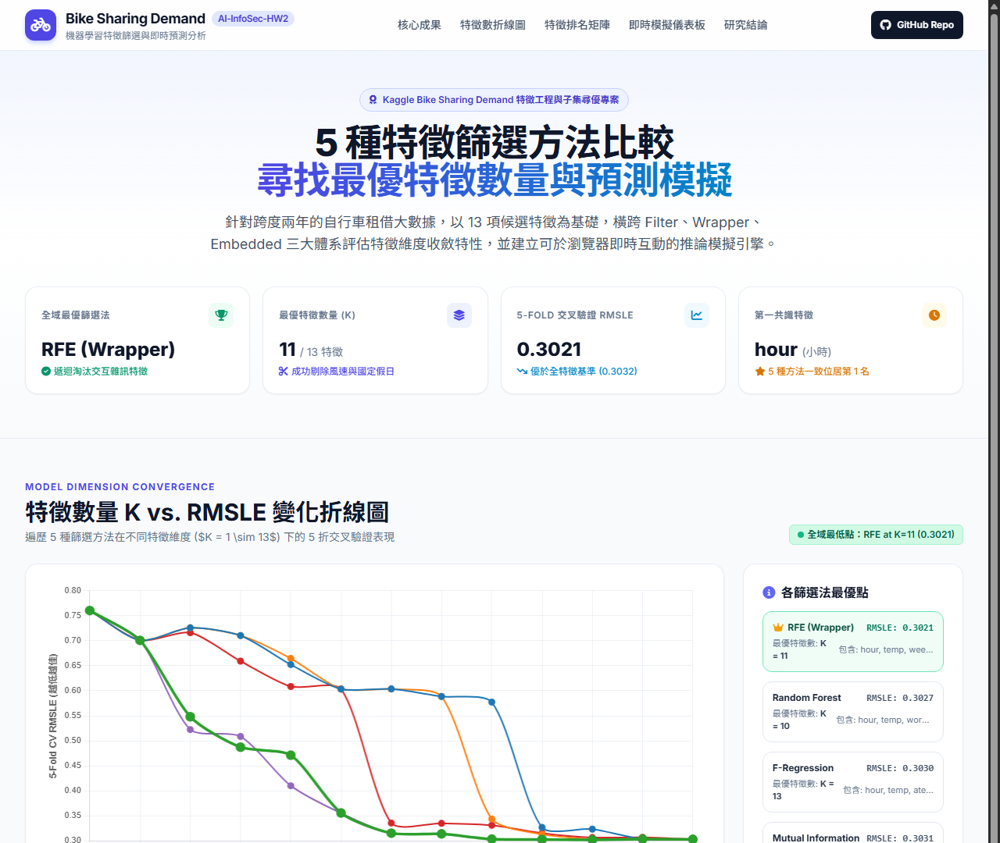
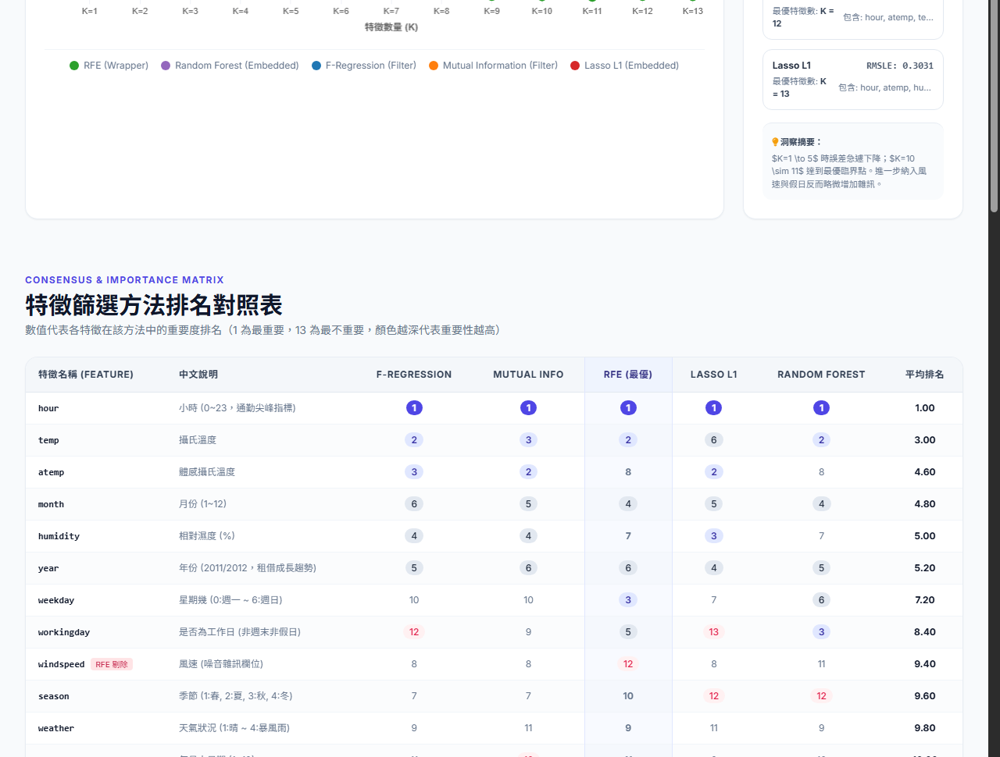

# 🚲 AI-InfoSec-HW2: Bike Sharing Demand 機器學習專案

> **作業 2：5 種特徵篩選方法比較、特徵維度尋優與即時預測模擬儀表板**

[](https://chenglianghsu.github.io/AI-InfoSec-HW2/)
[](https://www.kaggle.com/c/bike-sharing-demand)
[](https://www.python.org/)

---

## 🌐 線上互動成果網頁 (GitHub Pages)

👉 **線上互動展示網址**：**[https://chenglianghsu.github.io/AI-InfoSec-HW2/](https://chenglianghsu.github.io/AI-InfoSec-HW2/)**

本專案將機器學習分析成果與輕量化決策樹推論引擎封裝為純靜態互動式網頁，使用者可在瀏覽器中即時拖曳 11 項特徵調節拉桿，動態預測每小時自行車租借量與 24 小時需求變化曲線。

---

## 📸 成果 Demo 截圖

### 1. 5 種特徵篩選方法收斂分析與 K vs. RMSLE 變化折線圖
遍歷 $K \in [1, 13]$ 特徵數量進行 5-Fold 交叉驗證，呈現各方法之誤差收斂走勢與全域最優解：



### 2. 即時預測與 24 小時動態趨勢模擬儀表板
直接於瀏覽器運行隨機森林推論引擎，即時計算預測租借量、客群分配（通勤會員 vs. 臨時用戶）與 24 小時需求模擬：



---

## 🏆 核心實驗結果摘要

| 項目 | 實驗成果 |
| :--- | :--- |
| **全域最優篩選法** | **RFE (遞迴特徵消除 Wrapper)** |
| **最優特徵數量 ($K$)** | **$K = 11$**（自 13 項候選特徵中精準去噪） |
| **5-Fold 交叉驗證 RMSLE** | **`0.3021`**（優於全特徵基準 `0.3032`） |
| **第一共識特徵** | `hour`（小時，所有 5 種方法皆評為第 1 重要） |
| **最優特徵名單** | `hour`, `temp`, `weekday`, `month`, `workingday`, `year`, `humidity`, `atemp`, `weather`, `season`, `day` |
| **雜訊剔除成果** | 成功剔除 `windspeed`（風速）與 `holiday`（國定假日）兩項冗餘干擾特徵 |
| **Kaggle 提交檔案** | [`submission.csv`](submission.csv)（完成 6,493 筆測試集預測） |

---

## 🔬 5 種特徵篩選方法排名總覽

| 特徵名稱 | 中文說明 | F-Regression | Mutual Info | RFE (最優) | Lasso L1 | Random Forest | 平均排名 |
| :--- | :--- | :---: | :---: | :---: | :---: | :---: | :---: |
| **`hour`** | 小時 (通勤尖峰指標) | **1** | **1** | **1** | **1** | **1** | **1.00** |
| **`temp`** | 攝氏溫度 | 2 | 3 | 2 | 6 | 2 | 3.00 |
| **`atemp`** | 體感攝氏溫度 | 3 | 2 | 8 | 2 | 8 | 4.60 |
| **`workingday`** | 工作日 (非週末非假日) | 12 | 9 | 5 | 13 | 3 | 8.40 |
| **`humidity`** | 相對濕度 (%) | 4 | 4 | 7 | 3 | 7 | 5.00 |
| **`year`** | 年份 (2011/2012 成長趨勢) | 5 | 6 | 6 | 4 | 5 | 5.20 |
| **`month`** | 月份 (1~12) | 6 | 5 | 4 | 5 | 4 | 4.80 |
| **`weekday`** | 星期幾 (0~6) | 10 | 10 | 3 | 7 | 6 | 7.20 |
| **`weather`** | 天氣等級 (1~4) | 9 | 11 | 9 | 11 | 9 | 9.80 |
| **`season`** | 季節 (1~4) | 7 | 7 | 10 | 12 | 11 | 9.40 |
| **`day`** | 每月中日期 (1~19) | 11 | 12 | 11 | 9 | 10 | 10.60 |
| **`windspeed`** *(剔除)* | 風速 (高噪音) | 8 | 8 | **12** | 8 | 12 | 9.60 |
| **`holiday`** *(剔除)* | 國定假日 (稀疏冗餘) | 13 | 13 | **13** | 10 | 13 | 12.40 |

---

## 📋 作業規格與資料集定義

* **資料集概述 (Dataset Description)**：
  * **基準模型**：可透過 Kaggle Scripts 查看、Fork 與執行隨機森林基準模型。
  * **資料切分與預測目標**：提供跨度兩年的每小時租借紀錄。訓練集為每月 1～19 日，測試集為 20 日至月底。任務為僅依據租借發生前可得的歷史與氣象資訊，預測測試集各小時的自行車總租借量。
* **資料欄位定義 (Data Fields)**：
  * `datetime`：每小時日期與時間戳記。
  * `season`：季節（1 = 春季, 2 = 夏季, 3 = 秋季, 4 = 冬季）。
  * `holiday`：是否為國定假日。
  * `workingday`：是否為工作日（既非週末亦非假日）。
  * `weather`：天氣狀況：
    * 1：晴朗、晴少雲、局部多雲、陰多雲。
    * 2：薄霧 + 多雲、薄霧 + 碎雲、薄霧 + 少雲、薄霧。
    * 3：小雪、小雨 + 雷雨 + 疏雲、小雨 + 疏雲。
    * 4：大雨 + 冰雹 + 雷雨 + 霧、大雪 + 濃霧。
  * `temp` / `atemp`：攝氏溫度 / 體感攝氏溫度。
  * `humidity` / `windspeed`：相對濕度 / 風速。
  * `casual` / `registered`：非註冊會員每小時租借量 / 註冊會員每小時租借量。
  * `count`：自行車總租借次數（`casual + registered`，為競賽預測目標）。
* **評估指標 (Evaluation)**：
  * **評估標準**：以均方根對數誤差（Root Mean Squared Logarithmic Error, RMSLE）進行評估。
  * **計算公式**：
    $$\sqrt{\frac{1}{n} \sum_{i=1}^n (\log(p_i + 1) - \log(a_i + 1))^2}$$
    * $n$：測試集中的小時總數。
    * $p_i$：預測的租借量。
    * $a_i$：實際的租借量。
    * $\log(x)$：自然對數。
* **提交格式 (Submission Format)**：
  * 提交檔案必須包含標題列（Header），格式範例如下：
    ```csv
    datetime,count
    2011-01-20 00:00:00,0
    2011-01-20 01:00:00,0
    2011-01-20 02:00:00,0
    ```

---

## 🚀 專案結構與重現執行

```bash
AI-InfoSec-HW2/
├── index.html           # GitHub Pages 互動式分析成果與預測儀表板
├── data.js              # 儀表板輕量推論引擎與特徵分析數據檔
├── main.ipynb           # 作業核心 Jupyter Notebook (端到端實作與評估)
├── submission.csv       # 採用最優特徵子集訓練全量資料產出之 Kaggle 提交檔
├── train.csv            # 競賽訓練資料集 (10,886 筆)
├── test.csv             # 競賽測試資料集 (6,493 筆)
├── demo_overview.png    # README 展示圖 1 (特徵篩選收斂圖)
├── demo_dashboard.png   # README 展示圖 2 (互動預測儀表板)
└── README.md            # 專案報告與說明文件
```

### 本地執行說明
1. 啟動 Jupyter Notebook 執行 [`main.ipynb`](main.ipynb)，即可重現 5 種篩選方法與模型擬合流程。
2. 雙擊直接開啟 [`index.html`](index.html)，即可在瀏覽器離線使用預測模擬儀表板。
